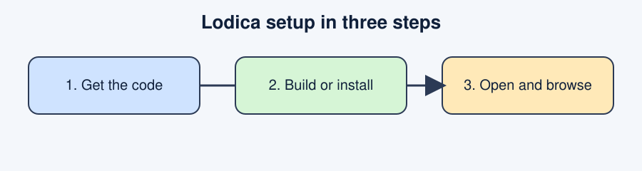
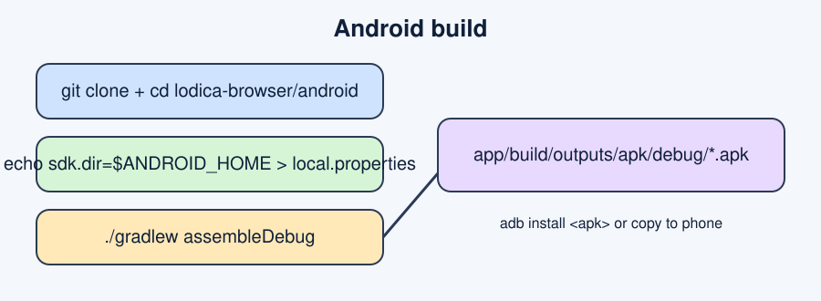
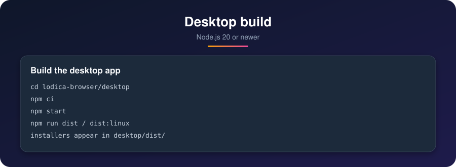
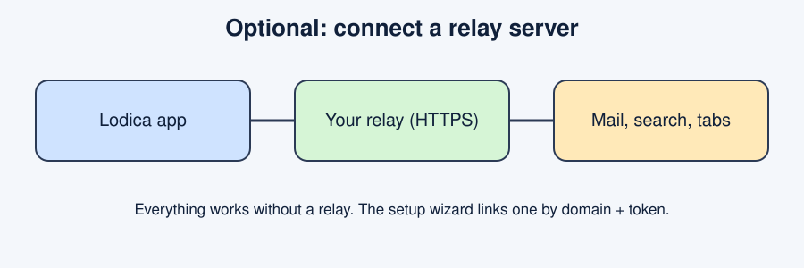

# Lodica

A privacy-focused browser for Android (GeckoView) and desktop (Electron), with vertical tabs, editable keybinds, customizable gestures, a built-in PDF viewer, ad blocking and a custom start page.



| Folder | What it is |
| --- | --- |
| `android/` | Android app (Kotlin, Jetpack Compose, GeckoView). Package id `be.syntaxya.lodica`. |
| `desktop/` | Desktop app (Electron). |

Both apps share one version number (currently 1.7.3).

## Highlights

- Search uses the engine you choose, on the start page, in the widget and on desktop.
- Quick sites on the start page, custom DNS rules (domain to redirect, as many as you like).
- With a relay: hidden email, tab sharing, server chat with private chats and groups, and notifications for new versions and new messages.
- Android widgets: search bar, shortcuts and quick sites.

 Everything works without a server. A relay is only needed for the optional hidden email, tab sharing and search features. The relay lives in `relay/` in this repository.

## Android

Requirements: JDK 17, Android SDK (platform and build-tools for the version in `android/app/build.gradle.kts`).



```bash
git clone <this repository>
cd lodica-browser/android
echo "sdk.dir=$ANDROID_HOME" > local.properties
./gradlew assembleDebug
adb install app/build/outputs/apk/debug/*.apk
```

Release builds need your own signing key: create `android/keystore/lodica.jks` (alias `lodica`) and run
`LODICA_KEYSTORE_PASS=<password> ./gradlew assembleRelease`. The `keystore/` folder is gitignored.

## Desktop

Requirements: Node.js 20 or newer.



```bash
cd lodica-browser/desktop
npm ci
npm start             # run from source
npm run dist:linux    # AppImage and deb in dist/
npm run dist          # Windows installer (untested)
```

## Optional: connect a relay



The relay is a server you host yourself (code in `relay/`). You need a Debian or Ubuntu VPS and a domain with a wildcard DNS record (`*.example.com`) pointing at the VPS. Then run, as root on the server:

```sh
curl -fsSL https://raw.githubusercontent.com/bent-syntax/lodica-browser/main/relay/deploy/install.sh | sudo bash -s -- example.com
```

It installs Node and the relay, installs [Caddy](https://caddyserver.com) if it is missing, and prints a token. Caddy routes `lodica.example.com` and `tunnel.example.com` and gets and renews their Let's Encrypt certificates by itself, so ports 80/443 must be reachable from the internet. If Caddy already runs, its existing sites are left alone: only hostnames it does not serve yet are added in `/etc/caddy/lodica-relay.caddy`, and the Caddyfile is backed up first. Everything is reachable on port **443**, so networks that block unusual ports still work: a small SNI router inside the relay owns 443, sends `lodica.<domain>` to the relay API and `tunnel.<domain>` to the relay proxy, and passes every other name to Caddy, which the installer moves to port 8443 (`https_port` in the Caddyfile). Nothing is decrypted by the router. The relay also keeps its own TCP ports **44741** (API) and **44742** (tunnel) as a fallback for older clients; the installer opens those in ufw. Open 80, 443 and those two in your host's web firewall too if it has one. Tune the router with `LODICA_EDGE_PORT`, `LODICA_EDGE_FALLBACK_PORT`, `LODICA_EDGE_API_HOST` and `LODICA_EDGE_TUNNEL_HOST` in `/etc/lodica-relay/relay.env`.

To use your own certificate instead of Caddy's:

```sh
curl -fsSL https://raw.githubusercontent.com/bent-syntax/lodica-browser/main/relay/deploy/install.sh | sudo env LODICA_TLS_CERT=/path/fullchain.pem LODICA_TLS_KEY=/path/key.pem bash -s -- example.com
```

Set `LODICA_API_PORT` / `LODICA_PROXY_PORT` to use other ports (the apps expect the defaults). Running it again updates the relay and keeps the token. The app's setup wizard shows this same command with your domain filled in. To link the apps:

- **Android:** open the setup wizard from Settings, enter your domain, then paste the token.
- **Desktop:** run `LODICA_API=https://lodica.<domain> LODICA_DOMAIN=<domain> LODICA_TOKEN_FILE=./relay-token npm run config`. This writes the gitignored `desktop/config.json`.

### Device gate and chat notifications

Hosts you list as gated only answer clients that send a per-device token. In the app choose Enroll; it shows an 8-character code (valid 10 minutes, single use). Approve it on the server with `sudo lodica-approve <code>`. The token is sent in the `X-Lodica-Gate` header (not a cookie) and only to the listed hosts. The relay token is shared between devices, so treat the pairing code as the real secret.

On Android, instant chat messages use a foreground service. Allow notifications when asked (POST_NOTIFICATIONS), and accept the battery exemption prompt so the system keeps the connection alive. The "Instant chat messages" switch turns it off. NFC pages: GeckoView has no Web NFC, so `NDEFReader.scan()` and `write()` reject with `NotSupportedError`; the desktop app does not support it either.

Without a relay these features stay hidden and the browser works normally.

## Notes

- Never commit `config.json`, `relay-token`, `keystore/` or `*.env`. They are gitignored.
- Feature list: `android/FEATURES.md`, `desktop/FEATURES.md`. Patch notes: `*/PATCH_NOTES.md`.
- Only the Android build was compiled here. The Windows build and real-device behavior are untested.

## License

MIT.
