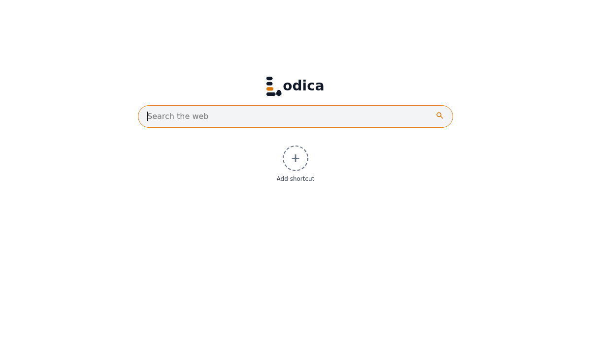
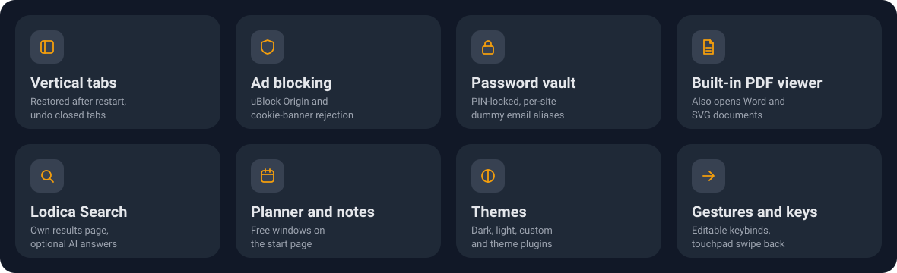
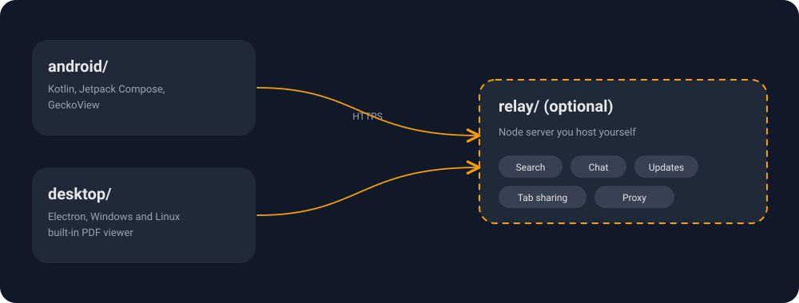

<p align="center">
  
</p>

<p align="center">
  <a href="https://github.com/bent-syntax/lodica-browser/releases/latest"></a>
  <a href="LICENSE"></a>
  
</p>

**Lodica** is a privacy-focused browser with vertical tabs, a password vault, built-in ad blocking and its own search page. It runs on Android (GeckoView) and on Windows and Linux (Electron). Everything works without a server; an optional self-hosted relay adds search, chat, tab sharing and update notices.



## Highlights

<p align="center">
  
</p>

- **Privacy:** uBlock Origin, automatic cookie-banner rejection, per-site data meter, per-site lite mode, anti-fingerprinting.
- **Vault:** per-site dummy email aliases and strong passwords, unlocked with biometrics (Android) or a PIN (desktop).
- **AI, optional:** Ask AI through your own Claude Code sign-in, with local encrypted memory. Off by default.
- **Desktop extras:** downloads with pause, resume and progress ring, two-finger touchpad swipe back/forward, translation of selected French or Dutch text, serial monitor, error page with retry.
- **Android extras:** home-screen widgets, web apps as real apps, picture-in-picture, reader mode with read-aloud.
- Full lists: [android/FEATURES.md](android/FEATURES.md), [desktop/FEATURES.md](desktop/FEATURES.md).

## Download

Get the latest build from [GitHub Releases](https://github.com/bent-syntax/lodica-browser/releases/latest). Current version: **1.14.2**.

| Platform | File |
| --- | --- |
| Windows installer | `Lodica-Setup-<version>.exe` |
| Windows portable | `Lodica-Portable-<version>.exe` |
| Linux AppImage | `Lodica-<version>.AppImage` |
| Linux Debian/Ubuntu | `Lodica-<version>.deb` |
| Android | `Lodica-<version>.apk` (allow installing unknown apps) |

## Project layout

<p align="center">
  
</p>

| Folder | What it is |
| --- | --- |
| `android/` | Android app (Kotlin, Jetpack Compose, GeckoView), package `be.syntaxya.lodica` |
| `desktop/` | Desktop app (Electron) |
| `relay/` | Node relay: proxy, search, support, updates, chat, push |
| `docs/` | Images, logos, theme plugin docs, [repo structure guide](docs/STRUCTURE.md) |

Both apps share one version number. Release history: [CHANGELOG.md](CHANGELOG.md).

## Build and test

Builds run only through GitHub Actions (`ci.yml` on push to `main`, `release.yml` on a `v<x.y.z>` tag).

```bash
npm test --prefix desktop            # desktop tests
node --test relay/test/*.test.js     # relay tests
```

Run the desktop app from source (Node.js 20 or newer):

```bash
cd desktop
npm ci
npm start
```

Android release builds need your own signing key at `android/keystore/lodica.jks` (alias `lodica`, gitignored).

## Optional: connect a relay

The relay is a server you host yourself (code in `relay/`). You need a Debian or Ubuntu VPS and a domain with a wildcard DNS record (`*.example.com`) pointing at it. As root on the server:

```sh
curl -fsSL https://raw.githubusercontent.com/bent-syntax/lodica-browser/main/relay/deploy/install.sh | sudo bash -s -- example.com
```

The installer sets up Node, the relay and [Caddy](https://caddyserver.com) (certificates are automatic) and prints a token. Port 443 must be reachable; the relay also keeps ports 44741 and 44742 as a fallback for older clients. Running it again updates the relay and keeps the token. To link the apps:

- **Android:** open the setup wizard from Settings, enter your domain, then paste the token.
- **Desktop:** run `LODICA_API=https://lodica.<domain> LODICA_DOMAIN=<domain> LODICA_TOKEN_FILE=./relay-token npm run config` in `desktop/`. This writes the gitignored `desktop/config.json`.

Without a relay these features stay hidden and the browser works normally. On Android, instant chat messages use a foreground service: allow notifications and the battery exemption when asked.

## Contributing and security

- Read [docs/STRUCTURE.md](docs/STRUCTURE.md) first. Versions stay in sync across `android/app/build.gradle.kts`, `desktop/package.json`, `CHANGELOG.md` and both `PATCH_NOTES.md` files.
- Never commit `config.json`, `relay-token`, `keystore/` or `*.env`; they are gitignored.
- Report problems or security issues to [lodica@syntaxya.be](mailto:lodica@syntaxya.be).

## License

[MIT](LICENSE)
